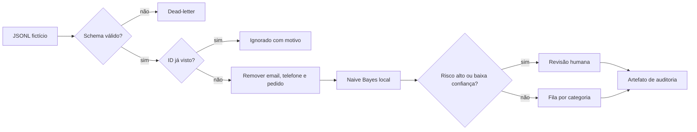

# Triage Flow Lab

> Uma demo local de automação/IA que sanitiza, classifica e roteia chamados fictícios sem enviar dados a serviços externos.

[](https://github.com/matheuspalma91-beep/triage-flow-lab/actions/workflows/ci.yml)
[](LICENSE)


## O problema

Triar uma caixa de entrada parece simples até surgirem três riscos: dados pessoais copiados para lugares indevidos, automações tomando decisões incertas e o mesmo evento sendo processado mais de uma vez.

Este laboratório mostra um fluxo pequeno, auditável e totalmente local. Ele usa um classificador Naive Bayes treinado apenas com frases fictícias, combina confiança com regras de risco e preserva uma saída sanitizada para revisão.

## Fluxo ponta a ponta



Entradas e saídas:

| etapa | entrada | saída |
| --- | --- | --- |
| validação | objeto JSON | válido ou `dead_letter` |
| sanitização | assunto e corpo | texto com `[EMAIL]`, `[PHONE]` e `[ORDER_ID]` |
| classificação | texto sanitizado | categoria e confiança |
| guardrail | confiança + urgência | fila automática ou revisão humana |
| auditoria | decisão final | JSON sem o dado bruto detectado |

## Demonstração reproduzível

O projeto inclui dados de treino, avaliação e inbox inteiramente fictícios. Execute:

```bash
git clone https://github.com/matheuspalma91-beep/triage-flow-lab.git
cd triage-flow-lab
npm ci
npm run check
```

O comando roda lint, oito testes e a demo. As saídas versionadas ficam em:

- [docs/demo-results.md](docs/demo-results.md): resumo legível e tabela de roteamento;
- [artifacts/triage-results.json](artifacts/triage-results.json): trilha estruturada para inspeção.

## O que é testado

- remoção de email, telefone e identificador de pedido;
- preservação de texto sem dados detectáveis;
- classificação das quatro categorias;
- medição separada no conjunto sintético de avaliação;
- idempotência por identificador;
- neutralidade dos marcadores de sanitização na classificação;
- revisão humana obrigatória para alto risco;
- envio de registros inválidos à dead-letter.

## Decisões técnicas

### Por que um modelo local e pequeno?

O objetivo é demonstrar o contrato da automação, seus guardrails e seus testes sem exigir token, custo ou envio de texto a terceiros. A decisão e suas limitações estão em [ADR 0001](docs/decisions/0001-local-classifier-with-guardrails.md).

### Por que confiança não decide sozinha?

Uma previsão confiante ainda pode envolver fraude ou invasão de conta. Regras explícitas mantêm casos de alto impacto sob revisão humana, enquanto baixa confiança evita automação forçada.

### Por que não registrar o texto bruto na saída?

Logs também vazam dados. O pipeline só persiste a versão sanitizada e a contagem de substituições. Em produção, a entrada bruta exigiria controles de acesso, retenção e finalidade definidos fora deste exemplo.

## Limitações honestas

- o dataset é pequeno, sintético e não mede desempenho no mundo real;
- regex não substitui uma solução completa de detecção de PII;
- a regra de telefone é conservadora e pode mascarar sequências numéricas de 8 ou 9 dígitos que não sejam telefones;
- a classificação cobre somente quatro categorias;
- o pipeline demonstra processamento em lote, não uma fila distribuída;
- não existe integração com help desk, email ou provedor de IA.

## Próximos passos

- [ ] adicionar matriz de confusão e métricas por categoria;
- [ ] testar textos adversariais e variações de formatação de telefone;
- [ ] definir política configurável de retenção de artefatos;
- [ ] criar uma interface de adaptador antes de integrar qualquer provedor externo.

## Contribuindo

Leia [CONTRIBUTING.md](CONTRIBUTING.md). Vulnerabilidades devem seguir [SECURITY.md](SECURITY.md), nunca uma issue pública.

## English summary

Triage Flow Lab is a fully local automation demo for fictional support tickets. It redacts common personal identifiers, classifies sanitized text, routes uncertain or high-risk cases to human review, and keeps a testable audit artifact without external APIs.

## Licença

Código distribuído sob a [licença MIT](LICENSE). Perfil: [@matheuspalma91-beep](https://github.com/matheuspalma91-beep).

